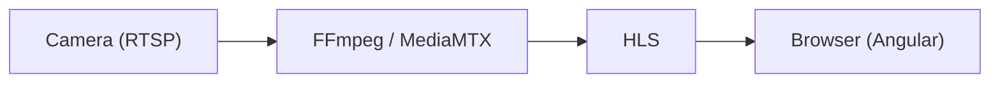
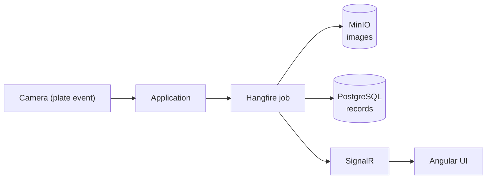

# Plaka Göz: Architecture Overview

> **Developed for and deployed at Erciyes University IT Department.**
> Live in production · 12 camera feeds · Dec 2025 – Jul 2026

Plaka Göz is a real-time multi-camera monitoring and vehicle tracking platform. It gives security operators a single interface to watch live camera feeds and respond to license plate recognition events as they happen.

This repository contains **architecture documentation only**. The source code is private because the system runs inside an institutional security infrastructure.

| | |
|---|---|
| **Client** | Erciyes University, IT Department |
| **Role** | Sole Developer (system design, backend, frontend, deployment) |
| **Status** | In active production use |
| **Scale** | 12 live camera feeds |
| **Deployment** | Docker on a Linux server |
| **Source code** | Private (institutional system) |

---

## Overview

Inspired by professional systems such as HikCentral and iVMS, the platform combines live video, event processing, real-time notifications, and reporting in a single application. Detected vehicles appear instantly as color-coded event cards:

- 🟡 **VIP**
- 🔴 **Blacklisted**
- 🔵 **Personnel**

This lets operators follow the status of vehicles attempting to enter the university in real time.

## How It Works

The system is built around two independent pipelines.

### Video Pipeline

Camera RTSP streams are processed with FFmpeg and MediaMTX and converted to HLS for playback in the browser. Operators can switch between 1, 4, and 12-camera layouts.

### Alarm Event Pipeline

The application listens directly for license plate recognition events sent by the cameras. Each event is processed by a Hangfire background job that classifies the plate, registers previously unseen plates automatically, and generates secure image access links. Vehicle, plate, and full-scene images are stored in MinIO, and SignalR pushes the processed event to all connected monitoring clients in real time.

## Key Features

- Live monitoring dashboard with 1, 4, and 12-camera layouts
- Real-time VIP / Blacklisted / Personnel classification with one-click category updates
- Automatic registration of previously unseen plates
- Event images served through time-limited secure links
- Role-based access control with ASP.NET Core Identity, JWT access tokens, and database-controlled, revocable refresh tokens
- Date and status filtering with incremental record loading, without page refresh
- Reporting for reviewing recorded plate events

## Architecture

The backend is built with C# and .NET 8 following **Onion Architecture**, with dedicated Domain, Application, Persistence, Infrastructure, and SignalR layers. Application logic is organized with **CQRS**, **MediatR** handlers, and repository interfaces, which keeps business logic independent from infrastructure.

Key design decisions:

- **Hangfire for background work:** incoming camera events are never blocked by classification or image handling.
- **MinIO with expiring links:** sensitive surveillance images are never publicly accessible.
- **HLS for video delivery:** camera streams become playable in standard browsers without plugins.
- **Revocable refresh tokens:** sessions can be invalidated from the database side.

## Deployment

- Containerized and deployed to a production environment on a Linux server using Docker
- MediaMTX, MinIO, and supporting components run as containerized services
- A PowerShell installation script was prepared for Windows Server environments without Docker support; it installs the required components and registers them as automatically starting Windows services

## Technology Stack

| Area | Technologies |
|---|---|
| Backend | C#, .NET 8, ASP.NET Core, Entity Framework Core, MediatR, CQRS, Hangfire |
| Frontend | Angular |
| Real-time | SignalR |
| Data & storage | PostgreSQL, MinIO |
| Video | FFmpeg, MediaMTX, HLS |
| Security | ASP.NET Core Identity, JWT |
| Infrastructure | Docker, PowerShell |

## Documentation

- [Architecture](docs/architecture.md)
- [Video pipeline](docs/video-pipeline.md)
- [Alarm event pipeline](docs/alarm-event-pipeline.md)
- [Security](docs/security.md)
- [Deployment](docs/deployment.md)
- [Design decisions](docs/decisions.md)

## Notes

The source code and some screenshots are not public because the system runs within the university's infrastructure. Any visuals in this repository are representative; no real data appears in them. An architecture walkthrough and a reference are available on request.

## Contact

**Mehmet Çakmak** · [LinkedIn](#) · [Portfolio](#) · [email]

