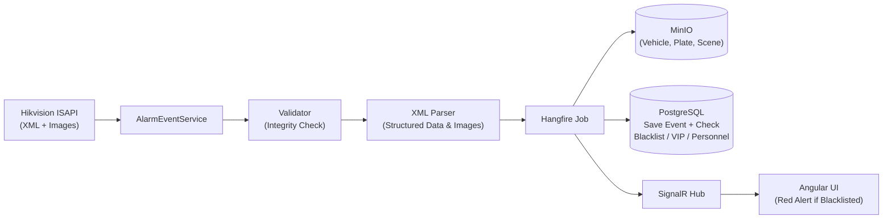

# Alarm Event Pipeline

The alarm event pipeline listens to **Hikvision ISAPI** plate recognition events, validates and parses the incoming XML and imagery, persists and classifies records against the database, and pushes color-coded real-time alerts to operators.

---

## Event Lifecycle

1. **Hikvision ISAPI Listener (`AlarmEventService`):**
   Cameras trigger plate recognition events via **Hikvision ISAPI**. The `AlarmEventService` continuously listens for incoming events.
2. **Integrity Check (`Validator`):**
   Before any processing occurs, a validator verifies the structural integrity and completeness of the incoming alarm payload.
3. **XML & Image Extraction (`Parser`):**
   A dedicated parser transforms the raw ISAPI XML payload into structured event metadata (plate number, timestamp, camera info) and extracts the attached images (vehicle, plate, and full-scene snapshots).
4. **Background Processing, Persistence & Classification (`Hangfire`):**
   - Persists the event record to **PostgreSQL** and uploads the extracted images to **MinIO** with time-limited secure access links.
   - Simultaneously checks PostgreSQL to determine whether the plate is registered under the **Blacklist** or **VIP** list (or **Personnel**), and automatically registers previously unseen plates.
5. **Real-Time Alerting (`SignalR` → `Angular UI`):**
   SignalR pushes the processed event to all connected operator dashboards in real time:
   - 🔴 **Blacklisted:** Displays a prominent **red alert** on the operator's screen.
   - 🟡 **VIP:** Displays a yellow VIP event card.
   - 🔵 **Personnel:** Displays a blue personnel event card.
