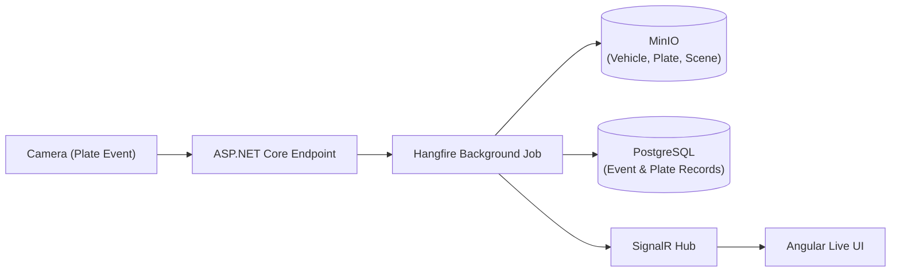

# Alarm Event Pipeline

The alarm event pipeline processes incoming Automatic License Plate Recognition (ALPR) events from cameras and pushes color-coded alerts to all connected operator dashboards in real time.

---

## Event Lifecycle

1. **Ingestion:**
   The application listens for HTTP/webhook recognition payloads emitted by the 12 cameras and immediately enqueues a **Hangfire** background job, returning fast acknowledgment to the camera.
2. **Classification & Auto-Registration:**
   - Looks up the recognized plate in PostgreSQL.
   - If the plate is new, automatically registers it so operators can track repeat entries.
   - Assigns status classification:
     - 🟡 **VIP**
     - 🔴 **Blacklisted**
     - 🔵 **Personnel**
3. **Image Storage & Secure Links (MinIO):**
   - Stores three artifacts per event: **vehicle crop**, **plate crop**, and **full-scene snapshot**.
   - Generates time-limited presigned URLs so surveillance images are never exposed publicly.
4. **Real-Time Broadcast (SignalR → Angular):**
   - Pushes the enriched event card over SignalR to all active operator sessions.
   - Operators can filter by date/status with incremental record loading (no page refresh) and update plate categories with one click.

