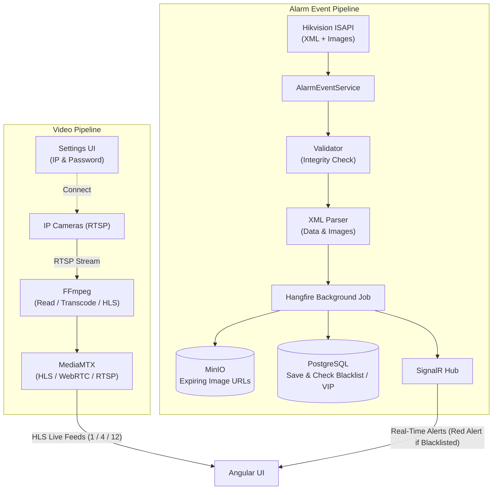

# System Architecture

Plaka Göz follows **Onion Architecture** on the backend (C# / .NET 8) to keep core domain rules decoupled from databases, object storage, media servers, and real-time messaging infrastructure.

---

## End-to-End System Flow

---

## Onion Architecture Layers

| Layer | Responsibility | Key Components & Technologies |
|---|---|---|
| **Domain** | Core entities (`Plate`, `Vehicle`, `Camera`, `AlarmEvent`), classification enums (`VIP`, `Blacklisted`, `Personnel`), domain rules | C#, .NET 8 |
| **Application** | Use cases, commands/queries, validation rules, repository & service interfaces | MediatR, CQRS |
| **Persistence** | Relational data access, EF Core mappings, Blacklist/VIP lookups, incremental filtering queries, refresh token storage | Entity Framework Core, PostgreSQL |
| **Infrastructure** | `AlarmEventService` (Hikvision ISAPI listener), `Validator`, `XML Parser`, Hangfire job orchestration, MinIO presigned URLs, Identity & JWT | Hangfire, MinIO SDK, ASP.NET Core Identity |
| **Presentation / Real-Time** | REST API endpoints, SignalR hub broadcasting, Settings & live monitoring dashboard | ASP.NET Core, SignalR, Angular |

---

## Core Architectural Principles

1. **Dependency Inversion:** Outer layers (Persistence, Infrastructure, Presentation) depend on interfaces defined in the Application/Domain core—never the reverse.
2. **CQRS with MediatR:** Read operations (incremental event history, status/date filtering, reporting) are separated from write operations (event ingestion, automatic unseen-plate registration, one-click category updates).
3. **Decoupled Pipelines:** Live video streaming ([Video Pipeline](video-pipeline.md)) and Hikvision ISAPI alarm processing ([Alarm Event Pipeline](alarm-event-pipeline.md)) operate independently so heavy video I/O never stalls real-time plate alerts.
