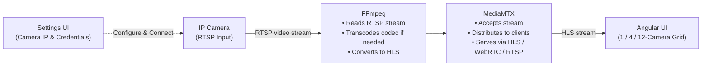

# Video Pipeline

The video pipeline connects institutional IP cameras configured in the system settings and delivers live streams to security operators in standard web browsers without requiring plugins or desktop clients.

---

## Stage Breakdown

1. **Camera Configuration & Connection (Settings Page):**
   From the **Settings** page, an authorized user enters the camera's **IP address and credentials (password)**. Once configured, the system establishes an authenticated connection to the IP camera.
2. **IP Camera (RTSP Input):**
   The connected IP camera outputs its live video feed as an **RTSP video stream**.
3. **FFmpeg (Stream Reader & Transcoder):**
   - Reads the incoming RTSP stream from the camera.
   - Performs codec conversion when required for browser compatibility.
   - Converts the stream into **HLS** format and forwards it to the media server.
4. **MediaMTX (Media Server & Distributor):**
   - Accepts the processed stream.
   - Distributes the live feed to connected clients.
   - Exposes playback endpoints over **HLS / WebRTC / RTSP**.
5. **Browser Playback (Angular UI):**
   The Angular frontend pulls the published stream (HLS) from MediaMTX and renders it in the monitoring dashboard, allowing operators to switch between **1**, **4**, and **12-camera** layouts.

---

## Operational Benefits

- **Dynamic Onboarding:** New cameras are connected directly through the Settings UI using their IP address and password.
- **Zero Browser Plugins:** Runs in standard browsers without ActiveX or custom RTSP desktop wrappers.
- **Isolation from Event Processing:** Video transcoding and distribution run independently from the .NET application server.
