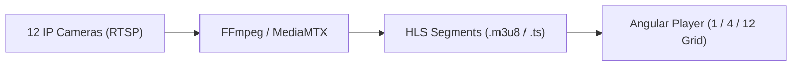

# Video Pipeline

The video pipeline delivers 12 concurrent live camera feeds to security operators in standard web browsers without requiring proprietary plugins or desktop clients.

---

## Stage Breakdown

1. **Camera Ingest (RTSP):**
   12 institutional IP cameras expose continuous RTSP streams over the internal security network.
2. **Media Relay & Packaging (FFmpeg + MediaMTX):**
   MediaMTX and FFmpeg pull RTSP feeds and package them into low-latency **HLS (HTTP Live Streaming)** playlists.
3. **Browser Playback (Angular):**
   The Angular frontend consumes HLS streams natively/via lightweight JS playback, allowing operators to switch seamlessly between:
   - **1-camera focus view** (detailed inspection)
   - **4-camera split view** (gate/zone monitoring)
   - **12-camera wall view** (full campus overview)

---

## Operational Benefits

- **Zero Browser Plugins:** Runs on any modern browser without ActiveX, Flash, or custom RTSP desktop wrappers.
- **Isolation from Event Processing:** Video packaging runs in its own MediaMTX container/service, independent from the .NET application server.

